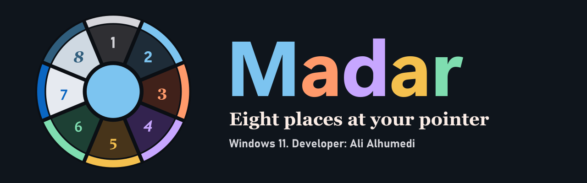
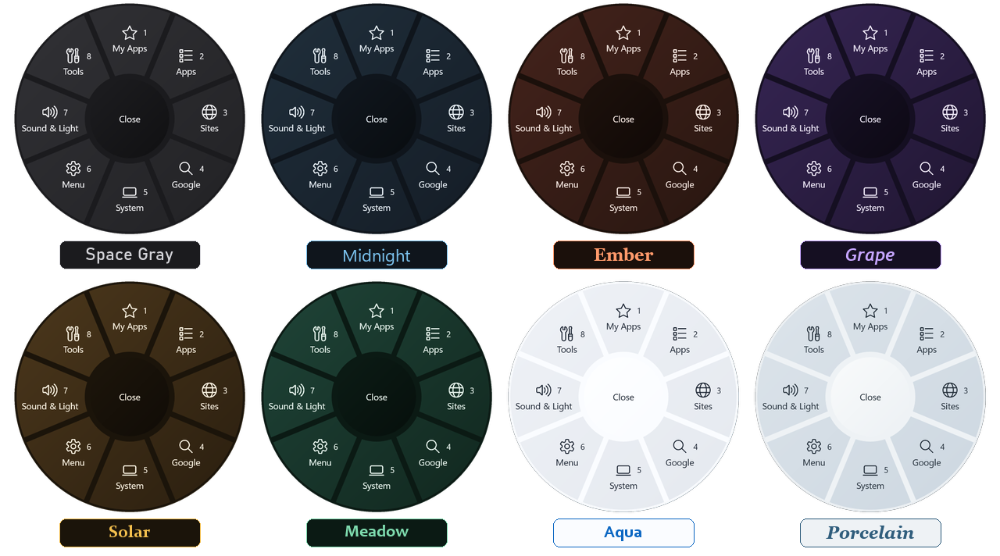
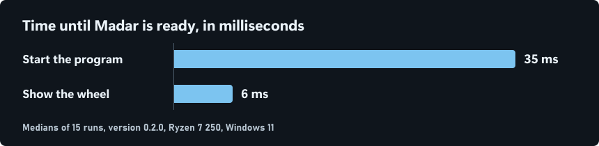

Madar shows a wheel of eight places at the mouse pointer: your programs, your sites, a Google search of the copied text,
system commands, and volume, brightness and Bluetooth. It is one EXE, makes no network calls and needs no account.

Developer: Ali Alhumedi.

<h2></h2>

<h2></h2>

Take `Madar-v0.3.0-windows-x64.exe` from the [latest release](https://github.com/alimwork85-web/Madar/releases/latest) and run it.
There is no installer. The EXE is not signed, so SmartScreen may warn: More info, then Run anyway.
A `.sha256` file next to it holds its checksum.

The interface is in English.

<h2></h2>

- Press Ctrl+Space. This is the default; Settings can change it.
- Press the mouse button chosen in Settings: Back (the default), Forward or Ctrl + Middle. None turns it off.
- Click the tray icon. A right click shows its menu: Open wheel, Settings, Pause, Theme, Exit.
- Start madar.exe again. A copy that is already running shows its wheel and the new one exits.

<h2></h2>

- Click a slot to open it. Click outside the wheel to close it.
- Hold the summon button and drag, then release on a slot.
- A digit opens the slot with that number. The number pad works too.
- Arrows, Tab and Shift+Tab move between slots. On the Sound & Light page Up and Down change the volume instead.
- Enter opens the highlighted slot. With none highlighted it works like Backspace.
- Backspace goes back from a folder, and closes the wheel at the top level.
- Esc closes the wheel. Clicking the hub works like Backspace.
- Right-click an item in My Apps, Apps, Tools or Sites for its menu: Edit, Replace from Start, Remove.
  Replace from Start puts another Start menu program in the same place and is not shown for sites.
  Remove asks first and takes the item off the wheel only; the program and its files stay.
  Afterwards the wheel opens again on the same page, ready for the next item.

The hub shows Close at the top level and Back inside a folder. A highlighted slot shows its name there.
On the Sound & Light page the hub shows the level as well, under the slot's name.

<h2></h2>

Every page has eight places. At the top level, clockwise from the top:

| Place | What it holds |
|---|---|
| My Apps | The programs you made, up to 8 |
| Apps | Your other programs, up to 8 |
| Sites | Your web links, up to 8 |
| Google | Google, or the results for the copied text |
| System | Run, Task Manager, Restart Explorer, Admin Terminal, Downloads, Shut down, Restart PC, Screen off |
| Menu | Opens Settings in Windows |
| Sound & Light | Volume, mute, Bluetooth, brightness and the output devices |
| Tools | Your tools, up to 8 |

While a list is not full, its next free place reads Add app or Add site and opens Settings at that list.
All other free places stay empty and the keyboard skips them.

<h2></h2>

System opens a page of its own. Clockwise from the top: Run, Task Manager, Restart Explorer, Admin Terminal,
Downloads, Shut down, Restart PC, Screen off.

Restart Explorer closes the folder windows, so it waits for a second press, 1 to 4 s after the first;
presses closer together count as one. The hub asks for it: Folders will close. Press again.
It then shows Restarting Explorer... and the wheel closes once the desktop is back.
Shut down and Restart PC wait for a second press in the same way. They are never forced,
so a program with unsaved work can stop them.

Admin Terminal opens Windows Terminal with administrator rights. Windows asks first, and refusing only closes the wheel.
Downloads opens the Downloads folder.
Screen off closes the wheel and turns the screens off 1 s later. The PC keeps working;
the mouse or a key turns them on. Whether Windows then asks to sign in is a Windows setting.

<h2></h2>

One press opens the results for the copied text in the default browser, or Google itself when there is none.
The copied text goes to Google through the browser. Madar itself makes no network calls.

Text counts as none when the program that copied it excludes it from others, when it is longer than 300 characters,
when it was copied more than 2 minutes ago, or when it was copied before Madar started. The clipboard is read and never changed.

<h2></h2>

Sound & Light opens a page of its own. Clockwise from the top: Volume up, Mute (Unmute while muted), Volume down,
Bluetooth, Brightness up, Brightness down, then the output devices by name, the one in use with a check mark.
Only connected devices are listed. The devices and the volume are read again every second while the page shows.
A Bluetooth device that is paired but not connected is not listed. With more than 2 devices the page shows the one in use, then More, which opens the sound page of Windows Settings.

A press on Volume up or Volume down goes to the next of 0, 5, 10, 20, 30 up to 100%.
The mouse wheel changes the volume by 2% a notch anywhere on the page but over the brightness places,
and over the Sound & Light slot at the top level. Up and Down change the volume by 2%. On the page Left, Right, Tab and Shift+Tab move between slots.
The wheel stays open after a change. Raising the volume unmutes.

The hub shows the level as a percentage, or Muted, or No output device, under the name of the highlighted slot. A highlighted device shows its name instead.

Bluetooth: one press turns it on or off, the wheel stays open and the hub shows the state.
With no radio, when refused, or with no change within 5 s it opens the Windows Bluetooth settings.

Brightness is of the built-in screen. A press, or the mouse wheel over either place, changes it by 2%, never below 5%.
The hub shows the level, or Brightness not available, and the wheel stays open. It is read when the page opens.

Choosing a device makes it the Windows default output. The default for calls is not changed.
Windows documents no call for this, so Madar uses an undocumented one in a short child process, reads the default back,
and opens the sound page of Windows Settings when the change did not happen.
The interface layout comes from com-policy-config by sidit77, under the MIT licence.

<h2></h2>

The Settings window changes the shortcut, the mouse button, the theme, the size, starting with Windows, Show names and the lists.

- Start with Windows follows Task Manager: an entry turned off there shows as off here. If the EXE was moved,
  running it once from its new place corrects the entry.
- A theme is picked by name from 8 themes, here or under Theme in the tray menu. Midnight is the default.
  The settings windows, the tray menu and the menu of an item take its colors too.
- Size is how large the wheel is: Large (the default), Medium (85%) or Small (75%). The next opening uses it.
- Show names off draws each slot as its icon alone, without label or digit. The digits still work.
- One list shows at a time: My Apps, Apps, Tools or Sites.
- Add asks for a name, a program path and optional arguments, or for a site a name, an http or https
  address and an optional browser. Browse picks the file; the Start menu button,
  for programs only, fills the path. Both fill an empty name, and so does the address of a site.
- Add from Start shows the Start menu program list with a search box, Store apps included.
- Buttons: Add, Add from Start, Edit, Remove, Move up, Move down, and Move to...
- Move to... opens a menu of the other two lists of programs, with a full one grayed.
  A program thus moves between My Apps, Apps and Tools.
- Add from Start is off for Sites. Move to... is off for Sites and when both other lists are full.
- Each list holds at most 8 items. Changes save at once; a failing control shows its error underneath.

<h2></h2>

Settings live in `%APPDATA%\Madar\config.json`. A key that is missing keeps its default, so a file
from an earlier version still loads.
If the file cannot be read, Madar starts with defaults and shows a warning.
The first change then asks before replacing it, and keeps a copy next to it.
A save that fails leaves the previous file in place.
The `MADAR_DIR` environment variable points Madar at another folder, for tests.

<h2></h2>

Idle in the tray it used 12 MB of private memory and no measurable CPU time over 10 s.

<h2></h2>

Rust stable with the MSVC toolchain, then:

    cargo build --release

The result is `target\release\madar.exe`. There are two direct dependencies: `serde_json` and `windows`.
The program makes no network calls, needs no account and has no updater.

<h2></h2>

MIT, see [LICENSE](LICENSE). © 2026 Ali Alhumedi. [THIRD-PARTY.txt](THIRD-PARTY.txt) holds the notice of com-policy-config.
